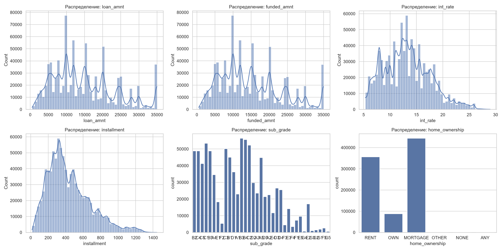
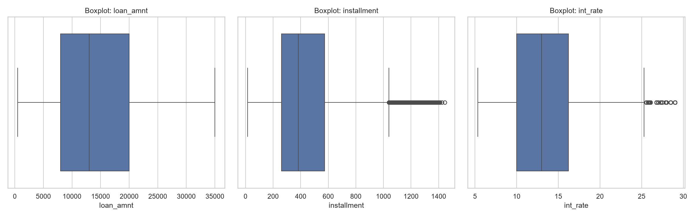
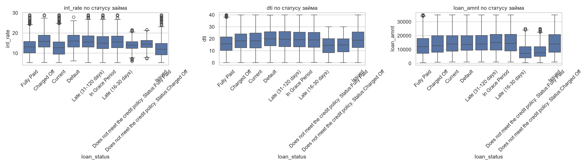
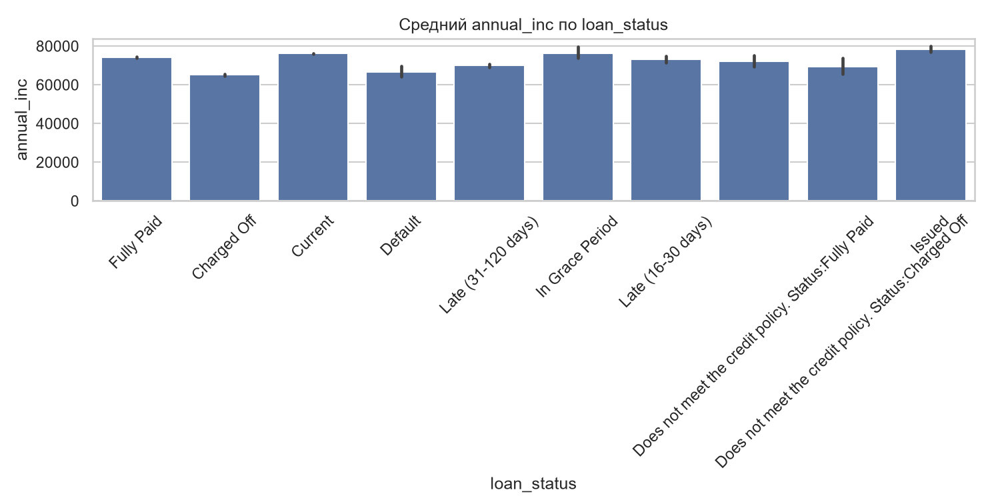
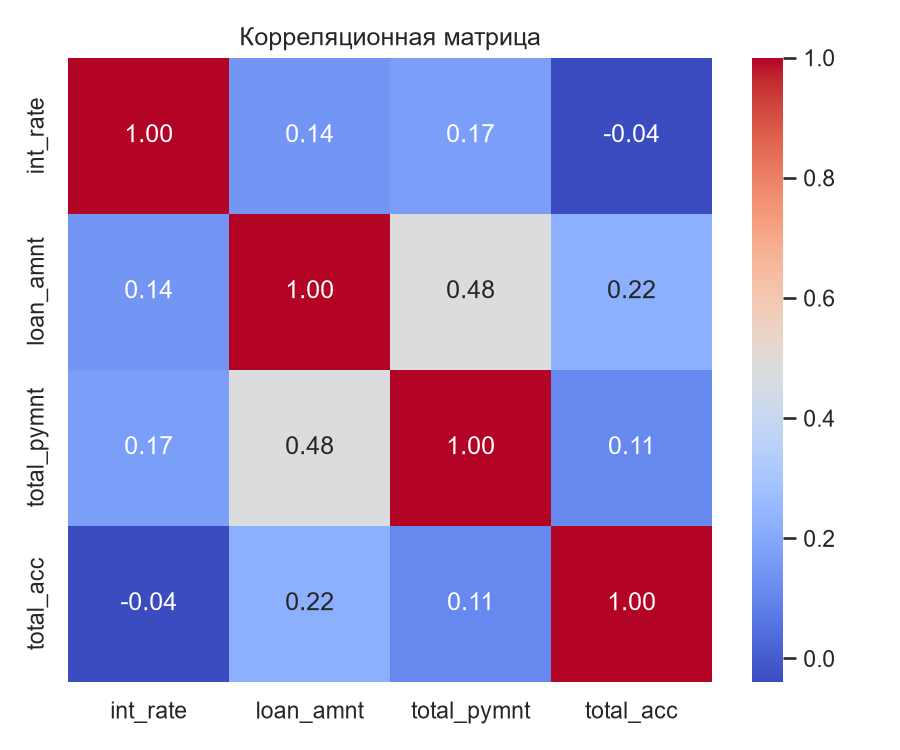
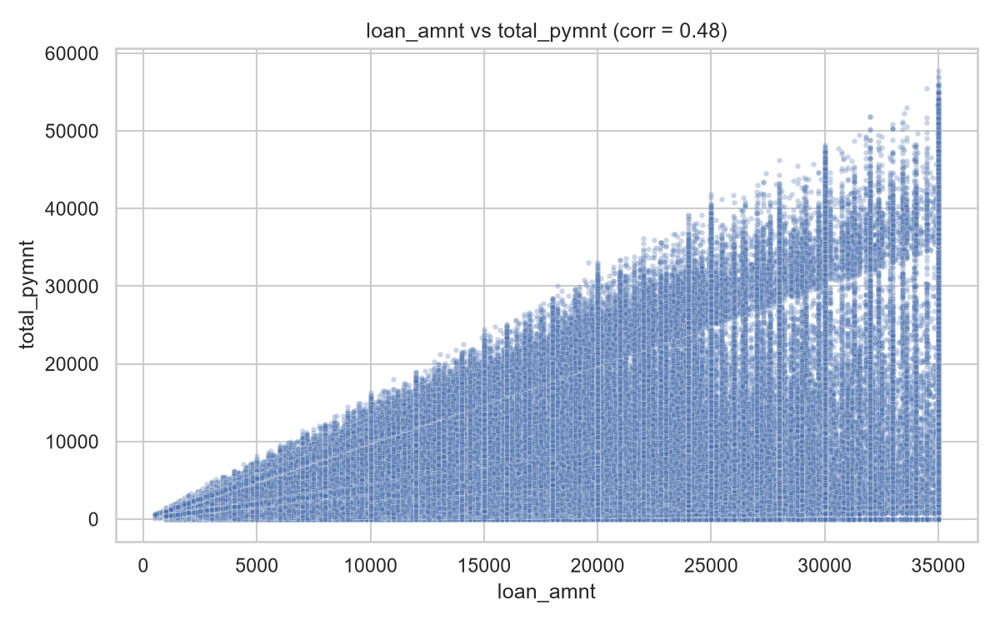

# Credit Risk Analysis


Разведочный анализ данных (EDA) о потребительских кредитах: очистка выборки, статистика по ключевым признакам и поиск связей между характеристиками заёмщика, условиями займа и его статусом.

## Описание

Проект посвящён анализу кредитного риска на реальных данных о займах. Датасет содержит около 887 тысяч заявок и 74 поля: сумма и ставка по кредиту, класс займа (`grade`, `sub_grade`), доход и закредитованность заёмщика, тип владения жильём, статус займа и платежи. Цель анализа — подготовить данные к дальнейшему моделированию и понять, какие признаки связаны с рисковыми статусами займов (дефолт, списание, просрочка).

Датасет взят из соревнования на Kaggle: [Credit Risk Dataset](https://www.kaggle.com/datasets/ranadeep/credit-risk-dataset/data).

Весь анализ выполнен в одном ноутбуке `credit_risk_analysis.ipynb` с помощью pandas, matplotlib и seaborn.

## Структура репозитория

```text
credit-risk-analysis/
├── data/
│   └── loan.csv                      # исходный датасет
├── notebooks/
│   └── credit_risk_analysis.ipynb    # анализ данных
├── images/                           # графики из ноутбука
└── README.md
```

Ноутбук читает данные по относительному пути `../data/loan.csv`, поэтому его нужно запускать из папки с ноутбуком, а файл `loan.csv` должен лежать в `data/`.

## Этапы анализа

| Этап | Что делается | Результат |
| :--: | ------------ | --------- |
| 1 | Загрузка `loan.csv` в `DataFrame` | 887 379 записей, 74 поля |
| 2 | Доли групп заявок по `application_type` | `INDIVIDUAL` — 99,94 %, `JOINT` — 0,06 % |
| 3 | Анализ пропусков: удаление малых групп и слабо заполненных полей | 886 868 записей, 52 поля |
| 4 | Анализ уникальных значений: удаление вырожденных полей | 886 868 записей, 48 полей |
| 5 | Анализ числовых полей: распределения, статистика, выбросы, связь со статусом займа, корреляции | Графики и выводы ниже |

### Очистка данных

**Малые группы.** Группа заявок `JOINT` составляет 511 записей (0,06 % выборки), что меньше порога 5 %, поэтому она удалена. После этого в `application_type` остаётся одно значение.

**Пропуски.** Удалены 22 поля, у которых доля пустых значений превышает 20 %. Среди них поля описания заёмщика и заявки (`desc`), данные о давности просрочек (`mths_since_last_delinq`, `mths_since_last_record`, `mths_since_last_major_derog`), все поля совместных заявок (`annual_inc_joint`, `dti_joint`, `verification_status_joint`, у которых пропусков 100 %), а также блоки показателей по рассрочкам и револьверным счетам (`open_il_*`, `open_rv_*`, `total_bal_il`, `il_util`, `max_bal_bc`, `all_util`, `inq_fi`, `total_cu_tl`, `inq_last_12m` и другие).

**Вырожденные поля.** Удалены поля, у которых меньше 10 уникальных значений и доля самого частого значения больше 80 %:

| Поле | Уникальных значений | Доля основного значения |
| ---- | :-----------------: | :---------------------: |
| `pymnt_plan` | 2 | 100,00 % |
| `policy_code` | 1 | 100,00 % |
| `application_type` | 1 | 100,00 % |
| `acc_now_delinq` | 8 | 99,54 % |

Такие поля не различают заёмщиков и не несут информации для анализа и моделей.

## Результаты

### Структура выборки

| Признак | Наблюдение |
| ------- | ---------- |
| `grade` | Основная доля займов приходится на классы B (28,69 %), C (27,71 %), A (16,71 %) и D (15,72 %); классы F и G — менее 3,5 % вместе |
| `home_ownership` | Ипотека (49,97 %) и аренда (40,14 %) покрывают 90 % заёмщиков; значения `OTHER`, `NONE`, `ANY` встречаются в долях менее 0,02 % |
| `verification_status` | Распределение сбалансировано: Source Verified 37,14 %, Verified 32,79 %, Not Verified 30,06 % |

### Сумма займа (`loan_amnt`)

| Статистика | Значение |
| ---------- | :------: |
| Минимум | 500 |
| Максимум | 35 000 |
| Среднее | 14 752,59 |
| Медиана | 13 000 |
| Стандартное отклонение | 8 434,36 |
| Квантиль 1 % | 1 800 |
| Квантиль 5 % | 3 600 |
| Квантиль 95 % | 32 000 |
| Квантиль 99 % | 35 000 |

- Среднее больше медианы: распределение суммы займа скошено вправо, часть заёмщиков берёт заметно более крупные суммы.
- Стандартное отклонение составляет около 57 % от среднего, то есть суммы займов довольно разнородны.
- Квантиль 99 % совпадает с максимумом (35 000): верхняя граница суммы займа ограничена продуктом, поэтому крупные значения представляют собой потолок, а не случайные выбросы.





### Связь со статусом займа

Для `int_rate`, `dti` и `loan_amnt` построены boxplot по статусам займа (`loan_status`).



- **Процентная ставка.** Медианная ставка у займов в статусах Charged Off, Default и Late заметно выше, чем у Fully Paid: более рискованным заёмщикам назначают более высокие ставки, и именно они чаще оказываются в проблемных статусах.
- **Отношение долга к доходу (`dti`).** У проблемных статусов (Charged Off, Default, Late) значения `dti` в среднем выше, чем у полностью выплаченных займов: более закредитованные клиенты чаще не справляются с обязательствами.
- **Сумма займа.** Различия между статусами по `loan_amnt` невелики. Исключение — статусы «Does not meet the credit policy», где суммы заметно меньше.
- **Выбросы.** У `int_rate` видны выбросы в области высоких ставок (выше примерно 25 %).

Средний годовой доход (`annual_inc`) по статусам:



Средний доход у займов Charged Off и Default (около 65–66 тыс.) ниже, чем у Fully Paid и Current (около 74–76 тыс.). Заёмщики с меньшим доходом чаще оказываются в проблемных статусах.

### Корреляции

Корреляционная матрица для полей `int_rate`, `loan_amnt`, `total_pymnt`, `total_acc`:

| | `int_rate` | `loan_amnt` | `total_pymnt` | `total_acc` |
| - | :--------: | :---------: | :-----------: | :---------: |
| `int_rate` | 1,00 | 0,14 | 0,17 | −0,04 |
| `loan_amnt` | 0,14 | 1,00 | **0,48** | 0,22 |
| `total_pymnt` | 0,17 | 0,48 | 1,00 | 0,11 |
| `total_acc` | −0,04 | 0,22 | 0,11 | 1,00 |



Наибольшая корреляция у пары `loan_amnt` и `total_pymnt` (0,48): чем больше сумма займа, тем больше заёмщик в итоге выплачивает. Связь умеренная, остальные пары практически независимы.



Корреляция не означает причинно-следственную связь: здесь она отражает механику займа (больший кредит ведёт к большим платежам), а не рисковое поведение заёмщика.

## Выводы

1. Выборка почти полностью состоит из индивидуальных заявок (99,94 %), поэтому группа совместных заявок для анализа неинформативна и удалена.
2. Многие поля заполнены слабо: из 74 полей удалены 22 с пропусками более 20 % и ещё 4 вырожденных, в итоге остаётся 48 полей.
3. На рисковые статусы займа указывают более высокая процентная ставка, более высокая закредитованность (`dti`) и более низкий доход заёмщика.
4. Суммы займов ограничены сверху значением 35 000 и распределены с правым хвостом.
5. Среди проверенных числовых признаков сильных линейных связей нет, максимум — 0,48 между суммой займа и общей суммой платежей.

## Возможные направления развития

- Заполнить пропуски в оставшихся полях и закодировать категориальные признаки.
- Построить целевую переменную «дефолт / не дефолт» из `loan_status` и обучить модель классификации (логистическая регрессия, случайный лес, градиентный бустинг).
- Исключить признаки, которые становятся известны только после выдачи займа (например, `total_pymnt`), чтобы избежать утечки данных.
- Оценить качество моделей метриками ROC-AUC, precision и recall с учётом дисбаланса классов.

## Запуск

```bash
git clone https://github.com/DenkiGO/credit-risk-analysis.git
cd credit-risk-analysis
pip install pandas numpy matplotlib seaborn jupyter
jupyter notebook notebooks/credit_risk_analysis.ipynb
```

Файл `loan.csv` нужно разместить в папке `data/`. При чтении pandas может вывести `DtypeWarning` для полей `desc` и `verification_status_joint` со смешанными типами: эти поля удаляются на этапе очистки, поэтому на результат предупреждение не влияет.

## Технологии

Python 3, pandas, NumPy, Matplotlib, seaborn, Jupyter Notebook.